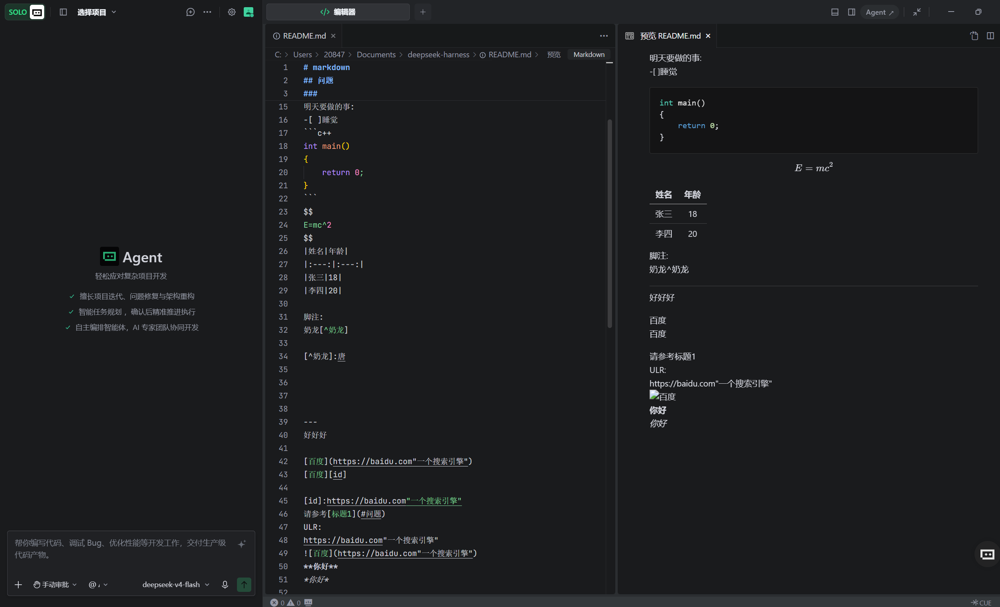
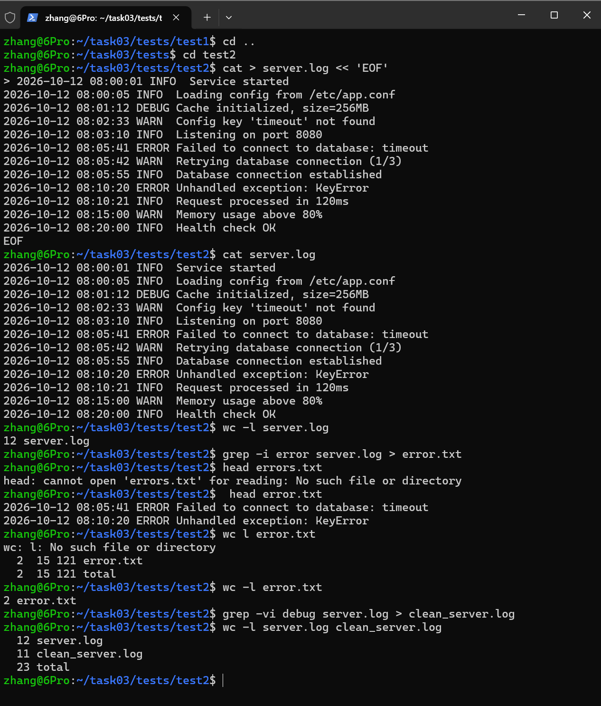
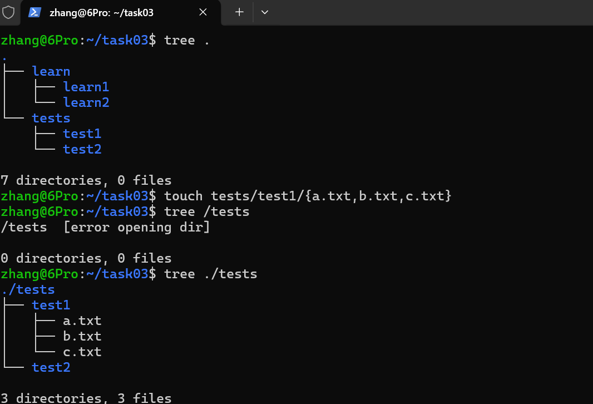
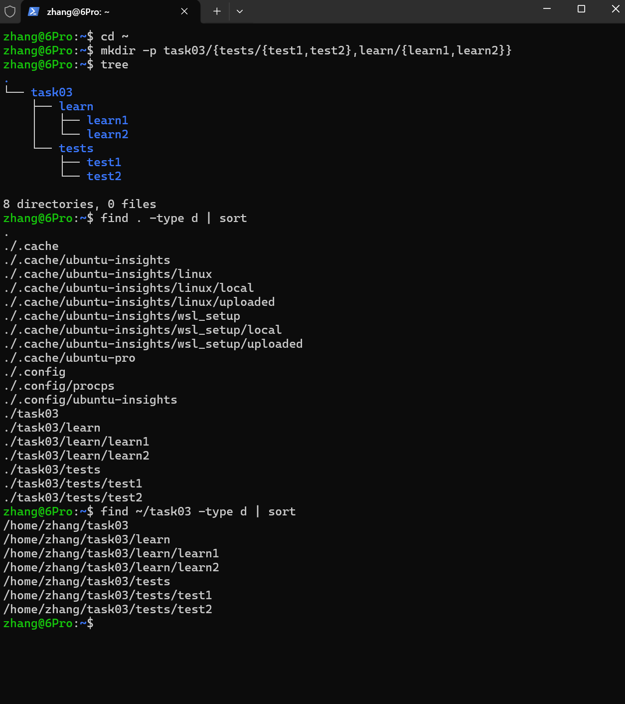
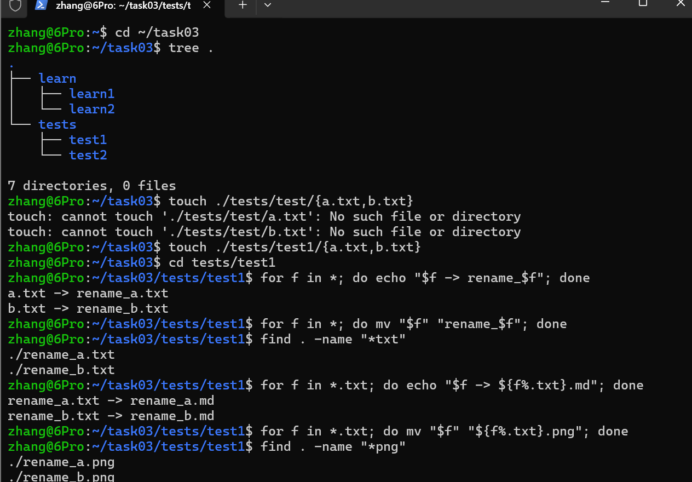

# 《AI-Lab 通识学习计划与环境踩坑记录.md》

---

## 常用命令
|命令|作用|注意|
|:---:|:---:|:---:|
|geep|  内容搜索|递归搜索时不要忘记 -r|
|rm|删除|最好用 rm -i|
|mkdir|创建目录|多层创建不要忘了 -p|
**......**

### 文件批量改名
```linux
for f in *;
do
mv '$f' 'rename_$f';
done

```
####操作截图






URL:https://wangdoc.com/bash/


