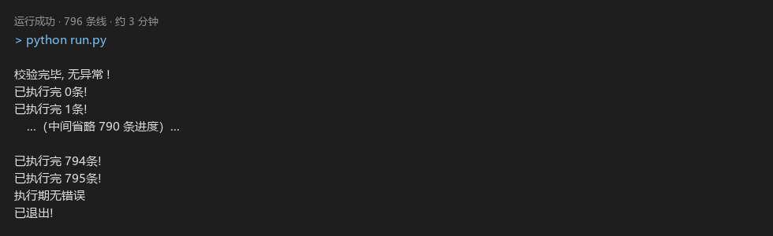
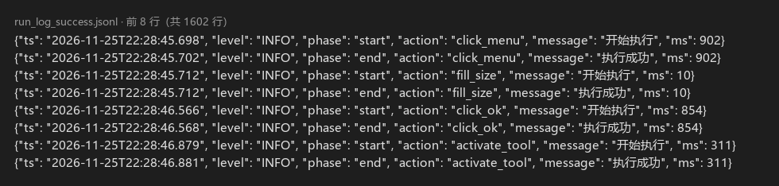
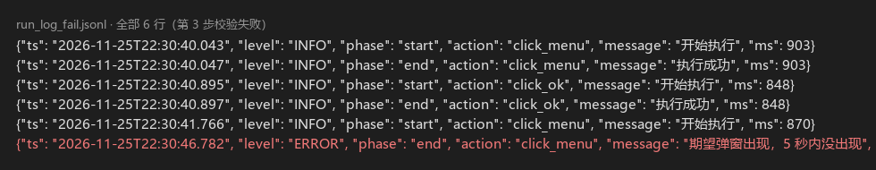

# miniPaint GUI 自动化（第 6 周）

读一份 JSON 轨迹 → 校验 → 逐条在 miniPaint 上执行 → 逐步检查 → 写日志和报告 → 导出图片。

## 运行

```bash
cd src
python run.py
```

依赖：`pip install playwright pillow numpy`，然后 `playwright install chromium`。
miniPaint 静态文件放在 `env/miniPaint-master`。

## 传进去的标准（轨迹）

一个 JSON 文件，`data/trace/trace.json`：

```json
{
  "task_id": "anime_final",
  "screen": {"width": 810, "height": 810},
  "steps": [
    {"step": 1, "action": "click_menu", "args": {"menu": "file", "item": "new"},
     "expect": {"dialog": "new_canvas"}},
    {"step": 2, "action": "fill_size", "args": {"width": 810, "height": 810},
     "expect": {"fields": [810, 810]}},
    {"step": 3, "action": "click_ok", "args": {}, "expect": {"canvas": [810, 810]}},
    {"step": 4, "action": "activate_tool", "args": {"tool": "brush"},
     "expect": {"tool": "brush"}},
    {"step": 5, "action": "draw_line",
     "args": {"path": "data/content/lines_full.jsonl", "index": 0},
     "expect": {"dirty": true}},
    {"step": 6, "action": "export_png",
     "args": {"filename": "anime", "path": "anime.png"},
     "expect": {"file": "anime.png"}}
  ]
}
```

规则：

| 字段 | 要求 |
| --- | --- |
| `steps` | 必须有，非空列表 |
| `step` | 序号；缺了就用位置序号 |
| `action` | 必须是下面 7 个之一 |
| `args` | 各动作自己的参数，缺字段会报错 |
| `expect` | 可选；写了就按该动作的白名单检查 |

七个动作及其参数：

| 动作 | args | expect 可用键 |
| --- | --- | --- |
| `click_menu` | `menu`、`item` | `dialog`、`file` |
| `fill_size` | `width`、`height`（1~10000 的整数） | `fields` |
| `click_ok` | 无 | `canvas` |
| `activate_tool` | `tool`（brush/rectangle/text/fill/crop） | `tool` |
| `draw_line` | `path`（.jsonl 且文件存在）、`index` | `dirty` |
| `export_png` | `filename`（不含路径分隔符）、`path`（.png） | `file` |

线条数据单独放（`data/content/lines_full.jsonl`），一行一条线：

```json
{"id": 0, "width": 1, "points": [[620, 500], [620, 506], [619, 512]]}
```

`points` 是归一化到 0~1000 的坐标，执行时按画布尺寸换算。

## 传出去的标准（产物）

每次运行生成一个独立目录 `output/run_<时间戳>/`：

| 产物 | 说明 |
| --- | --- |
| `*.png` | 导出的图片 |
| `check/check_report.md` | 轨迹检测报告 |
| `log/run_log.jsonl` | 运行日志，一行一条 |

日志格式（每个动作两行，`phase` 区分开始/结束）：

```json
{"ts": "2026-11-25T22:28:45.698", "level": "INFO", "phase": "start", "action": "click_menu", "message": "开始执行", "ms": 902}
{"ts": "2026-11-25T22:28:45.702", "level": "INFO", "phase": "end", "action": "click_menu", "message": "执行成功", "ms": 902}
```

| 字段 | 含义 |
| --- | --- |
| `ts` | 时间，毫秒级 |
| `level` | `INFO` / `WARNING` / `ERROR` |
| `phase` | `start` / `end` |
| `action` | 动作名 |
| `message` | 人话说明 |
| `ms` | 这一步花了多少毫秒 |

## 画出来的图

796 条线、3047 个点，810×810 画布，耗时约 2 分半：


## 截图

运行成功：



成功日志：



失败日志（第 3 步期望弹窗，5 秒内没出现）：



## 可调参数（`src/config.py`）

```python
PORT = 8123                          # 本地静态服务器端口
VIEWPORT = {"width": 1400, "height": 1600}   # 浏览器窗口尺寸
TIMEOUT_MS = 15_000                  # 所有等待的上限（毫秒）
OUTPUT_DIR = ROOT / "output"         # 产物目录
ACTIONS = { ... }                    # 动作白名单
```

`ACTIONS` 里 `click_menu` 的子项为空列表表示“这个菜单还没接入”，校验会直接拒绝。

## 目录

```
src/        源码（run / trace_check / verify / actions / report ...）
data/       trace.json + 线条数据
images/     文档截图
output/     每次运行的产物
env/        miniPaint 本体（不入库）
```
